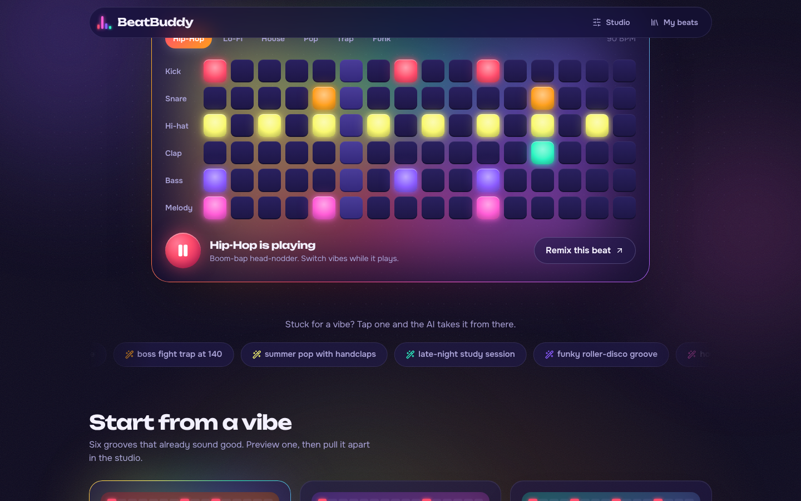
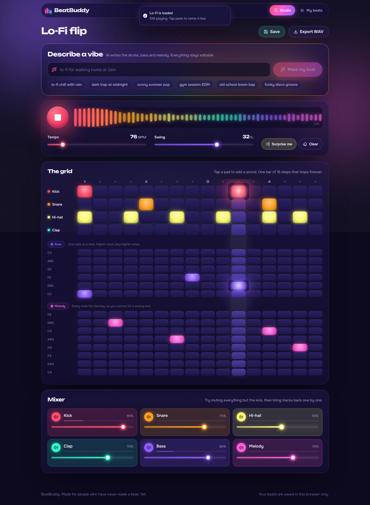
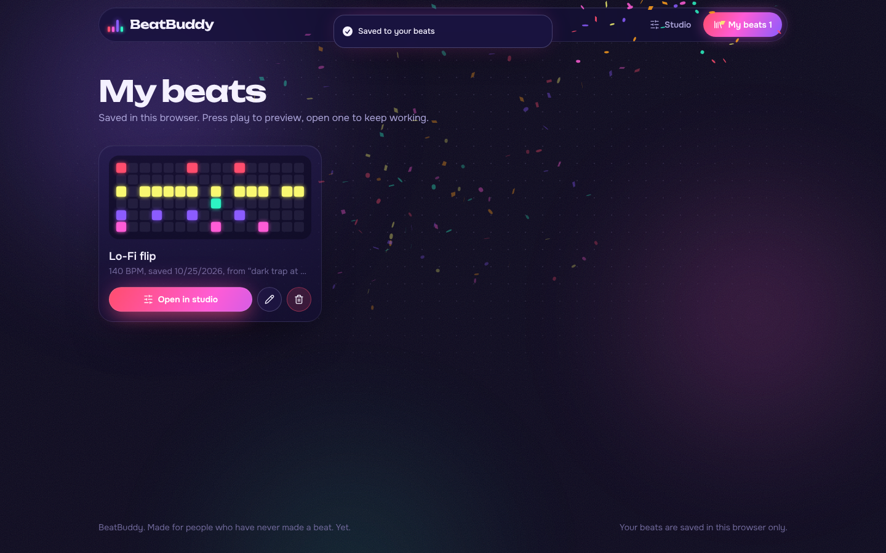
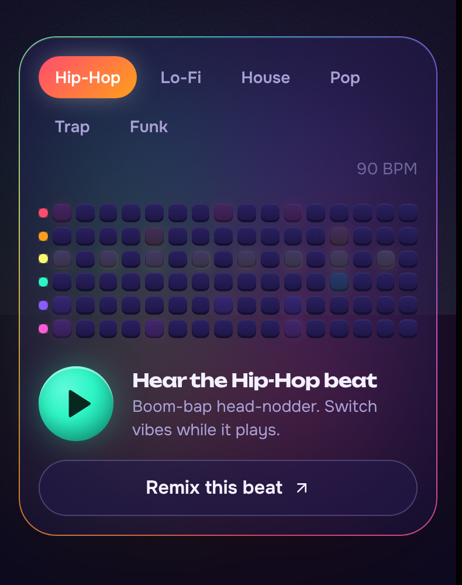

# BeatBuddy

**Play it now: https://somersetnomad.github.io/beats-buddy/**

**Tap the lights. Make a beat.** An AI beat maker for people who have never made a beat. Describe a vibe, get a full groove (drums, bass, melody), then light up pads to make it yours and export a WAV.



## What's inside

- **Playable hero.** The pad controller on the home page is a real instrument: press play, switch vibes live, then "Remix this beat" hands the loop to the studio without the music stopping.
- **Glowing step sequencer.** Neon pads flash when the playhead hits them, a light beam tracks the beat, and the whole stage (aurora, play button, headline glow) pulses with the kick and snare.
- **Live spectrum visualizer** fed from a Web Audio analyser, plus per-track level meters in the mixer.
- **AI vibe → beat** via `/api/generate`, with a built-in vibe library as fallback so it always returns something playable.
- **Preview before you load.** Every preset and saved beat can be auditioned in place, with a live mini-pattern as cover art.
- **Save, rename, delete** (localStorage) and **WAV export** (4 loops, 44.1 kHz, bus-compressed).
- Space to play/stop, confetti on save and generate, reduced-motion respected, responsive down to phones.
- Full favicon set: SVG icon, multi-size `favicon.ico`, Apple touch icon, and a web manifest with maskable icons so it installs as an app.

| Studio | Library | Mobile |
| --- | --- | --- |
|  |  |  |

## Run it

```bash
bun install        # or npm install
bun run dev        # http://localhost:3000
```

Production: `bun run build && bun run start`.

## Single-file build (Claude artifact)

`npm run build:artifact` (needs `esbuild`: `npm i -D esbuild`) bundles the whole app into `dist/beatbuddy.html`. Published as a Claude artifact with the `sample` and `downloads` capabilities, beats are written by the viewer's Claude and exports save as a `.zip` holding the WAV. Without a Claude runtime it falls back to `/api/generate`, then to the built-in vibe library.

## GitHub Pages

`node scripts/artifact/build.mjs --pages` writes a standalone `index.html` at the repo root (with `.nojekyll`), which Pages serves from `main`. Rebuild and commit it after changing the app. On Pages there is no server, so beats come from the built-in vibe library and Export downloads the WAV directly.

## Stack

Next.js 16, React 19, Tailwind CSS 4, Framer Motion, Web Audio API (synthesised kit, lookahead scheduler, OfflineAudioContext export), canvas-confetti, self-hosted Unbounded + Onest variable fonts.

## Key files

- `src/app/page.tsx` — state, audio engine wiring, audition logic, beat-reactive pulse, shortcuts
- `src/components/beat/` — `HomeView`, `StudioView`, `StepGrid`, `LibraryView`, `Visuals` (spectrum + mini patterns)
- `src/lib/beat/audio-engine.ts` — synth voices, scheduler, bus compressor + analyser, WAV renderer
- `src/app/globals.css` — design tokens, glow, pads, aurora stage, animations
- `src/app/icon.svg`, `favicon.ico`, `apple-icon.png`, `manifest.ts` — icons
